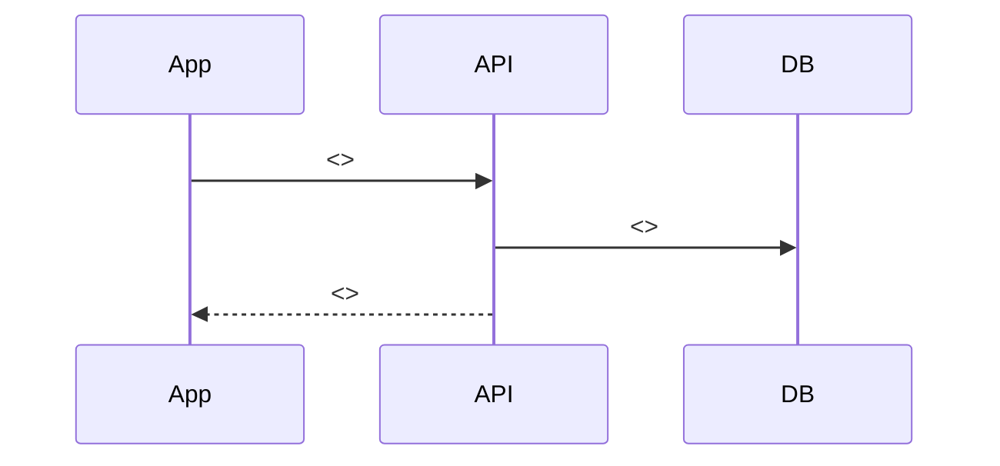
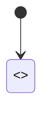

# F-000 <機能名>: 設計

機能ごとの **今の設計** を書く文書（ヘルプ AI には渡さない）。pending の要件定義書で変える節には、見出しのすぐ下に `> 未実装（REQ-xxxx）` を置き、実装し終えたら外す。

## 概要

<この機能が何をするかを 2〜3 行で。利用者から見た説明は機能マスタにあるので、ここではシステムの視点で>

## 非ゴール

<技術面でやらないこと>

## 要件（EARS）

- When <きっかけ>, the <app / API> shall <振る舞い>
- While <状態>, the <app / API> shall <振る舞い>
- If <望ましくない条件>, then the <app / API> shall <振る舞い>
- The <app / API> shall <いつも成り立つこと>

## シーケンス

<利用者の流れごとに 1 つ>



## 状態



| 状態 | 表示 |
| --- | --- |
| 読み込み中 | <> |
| 空 | <> |
| エラー | <> |
| オフライン | <> |

## 画面

| 画面 | ルート | UI 案 |
| --- | --- | --- |
| <> | <例: /(tabs)/feed> | <docs/ui/REQ-xxxx/index.html> |

## API

| メソッド | パス | 入力 | 出力 | エラー |
| --- | --- | --- | --- | --- |
| <POST> | </favorites> | <スキーマの場所> | <> | <409 上限> |

## データ

```mermaid
erDiagram
  <ENTITY> {
    string id
  }
```

## 非機能・セキュリティ

<性能、オフライン対応、権限、個人情報の扱いのうち関係するものだけ>

## リリース

<フィーチャーフラグ、段階リリース、OTA で出せるかストアの審査が要るか>

## 受け入れ条件

<要件定義書の受け入れ条件を技術的に具体化したもの。それぞれに確かめるテストか Maestro のフローを書く>

- Given <> When <> Then <>（.maestro/<>.yaml）

## 計測

<tracking/F-000.yaml のイベントの要約>

## 実装メモ

<実装していて設計から変えたこと。最後の PR のレビューガイドに載せる>
